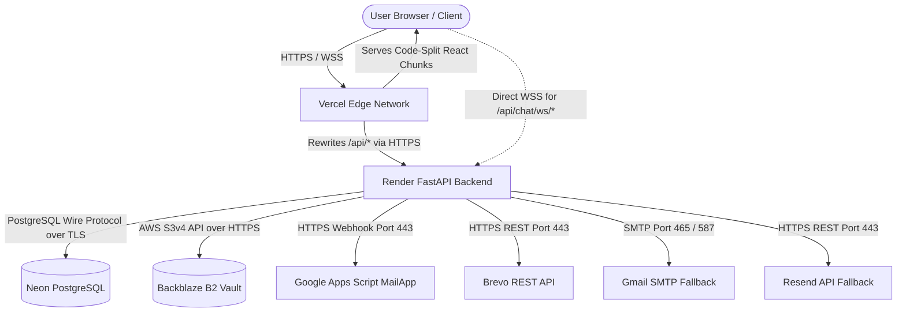
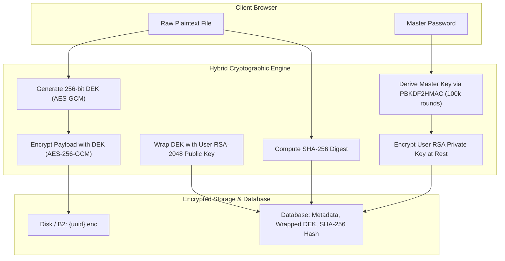

# SecureCloud — Zero-Knowledge Hybrid Cryptographic Cloud Storage & Vault

<div align="center">

[](https://opensource.org/licenses/MIT)
[](https://securecloud.vercel.app)
[](https://securecloud-i0qq.onrender.com)
[](https://neon.tech)
[](https://www.backblaze.com/b2/)
[](https://fastapi.tiangolo.com/)
[](#-cryptographic-architecture)
[](#-cryptographic-architecture)
[](https://vitejs.dev/)
[](https://tailwindcss.com/)
[](https://threejs.org/)
[-brightgreen.svg)](#-automated-testing-framework)

**SecureCloud** is an enterprise-grade, zero-trust cloud file storage platform, personal encrypted text repository, private real-time chat, and credential vault. Engineered with hardware-accelerated hybrid cryptography (**RSA-2048 PKI + AES-256-GCM**), automated storage quota allocation, multi-tier email dispatch, live telemetry, and interactive **Three.js WebGL 3D visualizations**.

🌐 **Live Production Frontend**: [https://securecloud.vercel.app](https://securecloud.vercel.app)  
⚡ **Live Production Backend**: [https://securecloud-i0qq.onrender.com](https://securecloud-i0qq.onrender.com)  
📖 **Technical Case Study**: [docs/TECHNICAL_CASE_STUDY.md](docs/TECHNICAL_CASE_STUDY.md)  

</div>

---

## 📑 Table of Contents
1. [System Architecture Overview](#-system-architecture-overview)
2. [Key Features](#-key-features)
3. [Cryptographic Architecture & Security](#-cryptographic-architecture--security)
4. [Multi-Cloud Production Infrastructure](#-multi-cloud-production-infrastructure)
5. [Complete Tech Stack](#-complete-tech-stack)
6. [Database Models (20 SQLAlchemy Entities)](#-database-models-20-sqlalchemy-entities)
7. [Frontend Architecture (22 Sub-Websites & 29 Components)](#-frontend-architecture-22-sub-websites--29-components)
8. [Core Algorithms & Business Logic](#-core-algorithms--business-logic)
9. [API Endpoints Reference (79 Endpoints)](#-api-endpoints-reference-79-endpoints)
10. [Local Development & Quick Start](#-local-development--quick-start)
11. [Docker Deployment](#-docker-deployment)
12. [Automated Testing Framework (8 Suites)](#-automated-testing-framework-8-suites)
13. [Environment Configuration](#-environment-configuration)
14. [License & Credits](#-license--credits)

---

## 🏛️ System Architecture Overview



---

## ✨ Key Features

- **🔒 Zero-Knowledge Hybrid Encryption**:
  - Every file payload is encrypted using a unique, cryptographically random **256-bit symmetric Data Encryption Key (DEK)** via `AES-256-GCM` with 12-byte random nonces.
  - The symmetric DEK is wrapped using asymmetric **RSA-2048 Public Key Cryptography** (`OAEP SHA-256`).
- **🛡️ Zero-Duplication User-to-User PKI Sharing**:
  - Securely share files with registered peers. The server unwraps the DEK and re-encrypts it directly with the recipient's RSA-2048 public key. Raw file ciphertext in Backblaze B2 is **never duplicated**.
- **🚫 Server-Enforced Instant Revocation**:
  - Revoking share access immediately invalidates authorization records and returns strict **`403 Forbidden`** barriers on download endpoints.
- **⏱️ Expirable Public Share Links**:
  - Generate standalone, password-protected download links with time-based expirations (1 hr, 24 hrs, 7 days, 30 days), download count caps, and guest download views.
- **✉️ Strict One-Step OTP Registration**:
  - Users are never inserted into the active user directory or granted storage until their 6-digit confirmation code is validated. Returning users with unverified emails can easily re-request fresh OTPs without account collisions.
- **📦 10 Dedicated Premium Storage Slots & Waiting Queue**:
  - Exactly 10 dedicated premium slots (1,000 MB per slot) with transparent queue positioning. When a slot is freed (account deletion, suspension, or demotion), eligible queue candidates are **automatically promoted**!
- **💬 Real-Time Encrypted 1-on-1 Chat**:
  - Real-time messaging powered by WebSockets (`/api/chat/ws/{conv_id}`), read receipts, message editing, soft-deletion, and encrypted file attachments.
- **📝 Personal Text Notes & Documents (1 MB Safe Text Quota)**:
  - In-browser markdown editor with live rendered preview, autosaving, and dedicated text storage quota tracking.
- **🔐 Zero-Knowledge Secret Vault**:
  - Isolated credential manager for API tokens, passwords, SSH keys, and encrypted memos.
- **👑 Executive Administrator Command Center**:
  - Full telemetry overview, user lifecycle controls (activate, suspend, delete, edit quota, force-verify, reset password, toggle admin), live OTP monitoring, audit logs, and support inquiries ticket management.
- **🌐 Interactive 3D WebGL Canvases**:
  - Three.js WebGL cryptographic security core (`SecurityCore3D.jsx`), interactive 3D mechanical vault dial (`VaultLock3D.jsx`), and interactive movable cyber canvas (`CyberCanvas3D.jsx`).
- **🔍 Cryptographic Integrity Center**:
  - Mathematical verification sweeps comparing on-disk and in-cloud ciphertext against immutable **SHA-256 checksums** to guarantee zero tampering or bit-rot.

---

## 🔐 Cryptographic Architecture & Security

SecureCloud adopts a **Zero-Trust Hybrid Cryptosystem** model:



### Cryptographic Specifications
| Mechanism | Primitive / Algorithm | Parameters (Code-Based) | Purpose |
| :--- | :--- | :--- | :--- |
| **Payload Encryption** | AES-GCM (Galois/Counter Mode) | 256-bit Key, 96-bit (12-byte) IV, 128-bit Auth Tag | High-speed authenticated confidentiality |
| **Key Wrapping & Exchange**| RSA-2048 OAEP SHA-256 | 2048-bit Keypair, MGF1(SHA-256) | Asymmetric DEK wrapping & zero-duplication sharing |
| **Password Hashing** | PBKDF2-HMAC-SHA256 | 16-byte random salt, 100,000 iterations | Protect user passwords against GPU/rainbow-table attacks |
| **Key Derivation at Rest** | PBKDF2-HMAC-SHA256 | `MASTER_KEY_SALT`, 100,000 iterations | Seal/unseal user RSA private keys at rest |
| **Integrity Verification** | SHA-256 | 256-bit Digest (64 hex characters) | End-to-end byte-for-byte checksum verification |
| **Session Authentication** | PyJWT (HMAC-SHA256) | HS256, 7-day expiration, UUIDv4 `jti` | Stateless Bearer token with revocation tracking |
| **Brute-Force Rate Limiter**| Memory-resident Sliding Window | 5 failed attempts per 60s, 60s lockout | Protect against automated credential stuffing |
| **Security Headers** | Starlette Middleware | `nosniff`, `DENY`, `max-age=31536000`, XSS filter | Enforce strict browser transport security |

---

## ☁️ Multi-Cloud Production Infrastructure

1. **Frontend Hosting — Vercel**:
   - Production URL: `https://securecloud.vercel.app`
   - Configured via `frontend/vercel.json` with automatic edge rewrites from `/api/(.*)` to the backend.
2. **Backend Hosting — Render**:
   - Production URL: `https://securecloud-i0qq.onrender.com`
   - Containerized Linux image (`backend/Dockerfile`) with Python 3.11-slim and Uvicorn multi-worker engine.
3. **Database — Neon PostgreSQL**:
   - Serverless PostgreSQL with SSL connection pooling (`asyncpg`).
4. **Cloud Object Storage — Backblaze B2**:
   - S3-compatible cloud bucket (`securecloud-vault` at `s3.us-east-005.backblazeb2.com`) via Boto3 with AWS S3v4 signature protocols and local disk fallback.
5. **Multi-Tier Email Delivery Engine**:
   - **Tier 1 (Primary)**: Google Apps Script Webhook on HTTPS (Port 443) running `MailApp.sendEmail()`. Dispatches to any inbox globally without port blocks.
   - **Tier 2**: Brevo REST API over HTTPS port 443.
   - **Tier 3**: Gmail SMTP over SSL (`smtp.gmail.com:465`) or STARTTLS (`587`).
   - **Tier 4**: Resend REST API (`api.resend.com/emails`).

---

## 🛠️ Complete Tech Stack

### Backend Stack
- **FastAPI** (`>=0.110.0`): Asynchronous ASGI framework for REST and WebSockets.
- **Uvicorn** (`>=0.28.0`): Concurrency ASGI web server.
- **SQLAlchemy** (`>=2.0.0`): Modern async ORM with `Mapped[]` type annotations.
- **Asyncpg** (`>=0.29.0`) & **Aiosqlite** (`>=0.20.0`): Database drivers for PostgreSQL & SQLite.
- **Cryptography** (`>=42.0.0`): OpenSSL primitives (`AESGCM`, `RSA`, `PBKDF2HMAC`, `OAEP`).
- **Python-Jose** (`>=3.3.0`): Cryptographic JWT handling.
- **Pydantic** (`>=2.6.0`): Runtime validation & schemas.
- **Boto3** (`>=1.34.0`): Cloud object storage SDK for Backblaze B2 / AWS S3.
- **Httpx** (`>=0.27.0`): Asynchronous HTTP client for Webhooks.

### Frontend Stack
- **React 18** (`^18.2.0`): Declarative UI with Concurrent Mode & Context API.
- **React Router 7** (`^7.18.4`): Client-side routing for 22 code-split sub-websites.
- **Vite 5** (`^5.1.6`): Build engine with lightning-fast HMR and optimized Rollup chunks.
- **Tailwind CSS v4** (`^4.3.3`): Utility-first CSS styling with customized dark glassmorphism design system.
- **Three.js** (`^0.162.0`): 3D WebGL interactive cryptographic visualizers.
- **Lucide React** (`^0.344.0`): Modern vector icon suite.

---

## 🗄️ Database Models (20 SQLAlchemy Entities)

All models are defined in [`backend/models.py`](file:///c:/Users/singh/Downloads/cloudstorage/backend/models.py):

| Model Name | Table Name | Description |
| :--- | :--- | :--- |
| **`User`** | `users` | User accounts, RSA-2048 keys, quotas, online presence, OTP code. |
| **`StorageAllocationSlot`** | `storage_allocation_slots` | 10 dedicated premium slots (1 to 10) assigned to users. |
| **`UserSession`** | `user_sessions` | Active JWT tokens (SHA-256 hashed), IP address, User Agent, revocation. |
| **`FileItem`** | `file_items` | File metadata, AES storage key, RSA encrypted DEK, SHA-256 checksum. |
| **`FileVersion`** | `file_versions` | Version snapshot history for rollback support. |
| **`Folder`** | `folders` | Hierarchical directories with parent/child structure and color badges. |
| **`ShareLink`** | `share_links` | Expirable public links with password protection and download caps. |
| **`UserShare`** | `user_shares` | Direct user-to-user sharing via recipient RSA DEK re-wrapping. |
| **`VaultSecret`** | `vault_secrets` | Passwords, API tokens, SSH keys, and encrypted credentials. |
| **`TextDocument`** | `text_documents` | Personal markdown notes and code memos with 1 MB text quota. |
| **`Conversation`** | `conversations` | Private 1-on-1 chat conversation threads. |
| **`ConversationParticipant`**| `conversation_participants`| Chat participants with `last_read_at` timestamps. |
| **`ChatMessage`** | `chat_messages` | Private chat messages with editing, soft-deletion, and attachments. |
| **`CommunicationRequest`** | `communication_requests`| Peer connection requests (`pending`, `accepted`, `rejected`, `blocked`). |
| **`UserConnection`** | `user_connections` | Confirmed peer connections and blocklist tracking. |
| **`Notification`** | `notifications` | In-app notifications with read status and actions. |
| **`SecurityAuditLog`** | `security_audit_logs` | Immutable administrative security audit trail. |
| **`ActivityLog`** | `activity_logs` | User-level activity history tracking file actions and logins. |
| **`SubscriptionRecord`** | `subscription_records` | Payment records, plan types, and subscription lifecycle. |
| **`ContactInquiry`** | `contact_inquiries` | Support inquiry tickets with status (`pending`, `resolved`). |

---

## 💻 Frontend Architecture (22 Sub-Websites & 29 Components)

### 22 Code-Split Independent Pages
1. `/overview` &mdash; Workspace dashboard, telemetry cards, quick uploads.
2. `/files` &mdash; Primary file manager with folder tree and file grid.
3. `/recent` &mdash; Chronological view of recently accessed and modified files.
4. `/favorites` &mdash; Starred files and pinned folders collection.
5. `/shared` &mdash; Inbound files shared with the user via RSA DEKs.
6. `/shared-links` &mdash; Public link manager to inspect and revoke active links.
7. `/trash` &mdash; Encrypted trash bin with restore and permanent purge.
8. `/vault` &mdash; Zero-knowledge credential secrets manager with 3D vault lock.
9. `/documents` (`/notes`) &mdash; Split-pane encrypted markdown editor with live preview and autosave.
10. `/chat` &mdash; Private 1-on-1 encrypted chat with real-time WebSocket connection.
11. `/contacts` &mdash; Peer directory search, incoming/outgoing connection requests.
12. `/pricing` (`/subscriptions`) &mdash; Active storage slot card, queue position, plan comparisons.
13. `/admin` &mdash; Executive Administrator Command Center (admin role required).
14. `/activity` (`/audit`) &mdash; Security event audit logs and session timeline.
15. `/integrity` &mdash; Merkle and SHA-256 cryptographic integrity verification center.
16. `/analytics` (`/stats`) &mdash; Categorical storage analytics and quota distribution graphs.
17. `/settings` &mdash; Profile management, RSA key fingerprints, active sessions table.
18. `/login` &mdash; Sign-in page with rate limiting and Google OAuth.
19. `/register` &mdash; One-step registration page with password strength checks.
20. `/verify-email` &mdash; 6-digit confirmation code verification screen.
21. `/share/:shareCode` &mdash; Public download portal for guest recipients.
22. `/contact` &mdash; Enterprise customer support ticket submission.

---

## ⚡ Core Algorithms & Business Logic

### 1. Strict One-Step OTP Registration
- User details submitted &rarr; record created with `is_verified = False`.
- User is **never** registered in the public directory or given a storage slot until OTP validation.
- Returning users with the same email/username refresh their pending record and receive a fresh OTP without collisions.

### 2. 10 Dedicated Premium Slots & Automated Queue Promotion
- Slots #1 to #10 provide 1,000 MB of cloud storage.
- If all 10 are occupied, new verified users enter the waiting queue (`queue_position = max + 1`) on the Basic plan (0 MB file quota, 1 MB safe text quota).
- When any slot-holding user is deleted, suspended, or demoted, `release_slot_and_promote_next()` automatically assigns the slot to the next verified queue candidate with 1,000 MB storage.

### 3. Authoritative Quota Calculation
- Client-reported file sizes are ignored.
- Storage usage is calculated authoritatively using `SELECT COALESCE(SUM(file_size), 0) FROM file_items WHERE user_id = :id AND is_trashed = false`.

### 4. 30-Day Trial Lifecycle
- Trials grant 30 days of Premium access. Upon expiration, un-subscribed accounts are gracefully demoted to Basic and trial files are purged to protect privacy.

---

## 📡 API Endpoints Reference (79 Endpoints)

<details>
<summary><b>Click to expand full 79 endpoint reference</b></summary>

### Authentication & Users
- `POST /api/auth/register` &mdash; Register account & send OTP.
- `POST /api/auth/verify-email` &mdash; Verify OTP, allocate slot & return JWT.
- `POST /api/auth/resend-code` &mdash; Resend 6-digit OTP code.
- `POST /api/auth/login` &mdash; Authenticate with username/email & password.
- `POST /api/auth/google` &mdash; Google OAuth 2.0 token exchange.
- `POST /api/auth/logout` &mdash; Invalidate current session token.
- `GET /api/auth/me` &mdash; Current user profile and quotas.
- `PUT /api/auth/me` &mdash; Update user profile and privacy settings.
- `POST /api/auth/change-password` &mdash; Change master account password.
- `POST /api/auth/send-password-otp` &mdash; Send OTP to reset password.
- `POST /api/auth/set-password-with-otp` &mdash; Set new password with OTP.
- `GET /api/auth/sessions` &mdash; List active login sessions.
- `POST /api/auth/sessions/{id}/revoke` &mdash; Revoke specific session.
- `POST /api/auth/sessions/revoke-all` &mdash; Revoke all other sessions.
- `DELETE /api/auth/me` &mdash; Permanently delete account and files.

### File Operations
- `GET /api/files` &mdash; List files with filter queries.
- `POST /api/files/upload` &mdash; Upload file with AES-256-GCM + RSA DEK encryption.
- `GET /api/files/{id}/download` &mdash; Decrypt and stream file payload.
- `GET /api/files/{id}/preview` &mdash; In-browser decrypted stream preview.
- `PATCH /api/files/{id}/favorite` &mdash; Toggle favorite status.
- `PATCH /api/files/{id}/trash` &mdash; Soft delete / restore file.
- `GET /api/files/{id}/versions` &mdash; File version history.
- `DELETE /api/files/{id}` &mdash; Permanently purge file.
- `PATCH /api/files/{id}/rename` &mdash; Rename file.

### Folder Operations
- `GET /api/folders` &mdash; List directory folders.
- `POST /api/folders` &mdash; Create folder.
- `PATCH /api/folders/{id}/favorite` &mdash; Star folder.
- `PATCH /api/folders/{id}/trash` &mdash; Trash folder.
- `DELETE /api/folders/{id}` &mdash; Permanently delete folder.

### Sharing Operations
- `POST /api/shares/user` &mdash; Direct peer sharing via RSA DEK re-encryption.
- `GET /api/shares/shared-with-me` &mdash; List files shared with user.
- `GET /api/shares/my-shares` &mdash; List files shared by user.
- `PATCH /api/shares/revoke/{id}` &mdash; Instantly revoke access (403).
- `POST /api/shares/block-sender/{id}` &mdash; Block user from sharing.
- `GET /api/shares/shared-file/{id}/download` &mdash; Download shared file.
- `POST /api/shares/create` &mdash; Create expirable public share link.
- `GET /api/shares/{code}` &mdash; Public share link metadata.
- `GET /api/shares/{code}/download` &mdash; Public link file download.

### Chat & WebSockets
- `GET /api/chat/conversations` &mdash; List 1-on-1 conversations.
- `POST /api/chat/conversations` &mdash; Start conversation.
- `GET /api/chat/conversations/{id}/messages` &mdash; Message history.
- `POST /api/chat/conversations/{id}/messages` &mdash; Post message.
- `PUT /api/chat/messages/{id}` &mdash; Edit message.
- `DELETE /api/chat/messages/{id}` &mdash; Soft-delete message.
- `WSS /api/chat/ws/{id}` &mdash; Real-time WebSocket connection.

### Personal Notes & Documents
- `GET /api/documents` &mdash; List personal notes.
- `POST /api/documents` &mdash; Create document.
- `GET /api/documents/{id}` &mdash; Fetch document.
- `PUT /api/documents/{id}` &mdash; Autosave / update document.
- `DELETE /api/documents/{id}` &mdash; Delete document.

### Zero-Knowledge Vault
- `GET /api/vault` &mdash; List decrypted credentials.
- `POST /api/vault` &mdash; Store encrypted credential.
- `DELETE /api/vault/{id}` &mdash; Delete credential.

### Contacts & Networking
- `GET /api/users/search` &mdash; Search users.
- `GET /api/users/profile/{uname}` &mdash; View profile.
- `POST /api/users/requests` &mdash; Send request.
- `GET /api/users/requests/incoming` &mdash; Incoming requests.
- `GET /api/users/requests/outgoing` &mdash; Outgoing requests.
- `POST /api/users/requests/{id}/respond` &mdash; Accept/reject request.
- `GET /api/users/connections` &mdash; Active connections.
- `POST /api/users/connections/{id}/block` &mdash; Block peer.

### Subscriptions & Quotas
- `GET /api/subscriptions/status` &mdash; Subscription & slot status.
- `GET /api/subscriptions/plans` &mdash; List plan tiers.
- `POST /api/subscriptions/start-trial` &mdash; Start 30-day trial.
- `POST /api/subscriptions/checkout-stripe` &mdash; Stripe checkout session.
- `POST /api/subscriptions/upgrade` &mdash; Upgrade plan.
- `POST /api/subscriptions/cancel` &mdash; Cancel plan.

### Administrator Command Center
- `GET /api/admin/overview` &mdash; Executive telemetry dashboard.
- `GET /api/admin/users` &mdash; User directory & quotas.
- `POST /api/admin/users/{id}/verify-email` &mdash; Force-verify user.
- `POST /api/admin/users/{id}/generate-otp` &mdash; Generate OTP.
- `POST /api/admin/users/{id}/reset-password` &mdash; Reset password.
- `PATCH /api/admin/users/{id}/quota` &mdash; Modify quota bytes.
- `PATCH /api/admin/users/{id}/toggle-admin` &mdash; Toggle admin status.
- `DELETE /api/admin/users/{id}` &mdash; Permanently delete user & vacate slot.
- `GET /api/admin/contact-inquiries` &mdash; Support inquiries list.
- `PATCH /api/admin/contact-inquiries/{id}/status` &mdash; Update ticket status.
- `DELETE /api/admin/contact-inquiries/{id}` &mdash; Delete ticket.
- `GET /api/admin/audit-logs` &mdash; System audit log trail.
- `GET /api/admin/slots` &mdash; 10 slot assignments.
- `POST /api/admin/users/{id}/action` &mdash; Suspend/activate/promote/demote user.

### Telemetry, Notifications & Public
- `GET /api/notifications` &mdash; User notifications.
- `GET /api/notifications/unread-count` &mdash; Unread badge count.
- `PUT /api/notifications/{id}/read` &mdash; Mark read.
- `PUT /api/notifications/mark-all-read` &mdash; Mark all read.
- `GET /api/stats/summary` &mdash; Storage & file statistics.
- `GET /api/stats/activity` &mdash; User activity timeline.
- `POST /api/contact/submit` &mdash; Public contact ticket submission.
- `GET /` &mdash; Service status & plan summary.
- `GET /health` &mdash; System health check.

</details>

---

## 🚀 Local Development & Quick Start

### Prerequisites
- **Python**: `3.10+`
- **Node.js**: `18.x+`
- **npm**: `9.x+`

### 1. Backend Setup
```bash
# Clone the repository
git clone https://github.com/ujwalx23/Securecloud.git
cd Securecloud

# Create and activate Python virtual environment
python -m venv backend/venv
# Windows (PowerShell)
backend\venv\Scripts\Activate.ps1
# macOS / Linux
source backend/venv/bin/activate

# Install dependencies
pip install -r requirements.txt

# Start backend dev server
uvicorn backend.main:app --reload --port 8000
```
*API will run at `http://127.0.0.1:8000` with Swagger docs at `http://127.0.0.1:8000/docs`.*

### 2. Frontend Setup
```bash
cd frontend

# Install Node modules
npm install

# Start Vite dev server
npm run dev
```
*Web application will be accessible at `http://localhost:5173`.*

### 3. One-Click Windows Launch
Double-click [`start_local.bat`](file:///start_local.bat) to simultaneously launch both the FastAPI backend and Vite frontend development servers.

---

## 🐳 Docker Deployment

To run both backend and frontend containerized via Docker Compose:

```bash
docker-compose up --build
```
- **Frontend**: `http://localhost:3000`
- **Backend API**: `http://localhost:8000`

---

## 🧪 Automated Testing Framework (8 Suites)

Execute the enterprise test runner:

```bash
# Run all 8 suites with in-memory SQLite isolation
$env:PYTHONPATH="."
python backend/tests/run_tests.py
```

### Verified Test Suites
- `[TEST 1]` User Registration & Unique Username Enforcing
- `[TEST 2]` Email Verification & Storage Slot Allocation
- `[TEST 3]` Login with Username, Password Validation & Sessions
- `[TEST 4]` Personal Text Notes & Document Quota Allocation
- `[TEST 5]` User Search, Communication Requests & Chat Authorization
- `[TEST 6]` 10 Dedicated Slots, Queueing & Auto-Promotion
- `[TEST 7]` Subscription Plans & Enterprise Inquiries
- `[TEST 8]` Google OAuth Endpoint Token Verification

**Result**: **ALL 8 TEST SUITES PASS WITH 100% SUCCESS**.

---

## ⚙️ Environment Configuration

Refer to [`.env.example`](file:///.env.example) for the complete list of environment variables:
- `DATABASE_URL` &mdash; Neon PostgreSQL connection URL (`postgresql+asyncpg://...`)
- `JWT_SECRET_KEY` &mdash; 256-bit cryptographic signing secret
- `STORAGE_BACKEND` &mdash; `"s3"` for Backblaze B2, `"local"` for local disk
- `S3_ENDPOINT_URL` &mdash; `https://s3.us-east-005.backblazeb2.com`
- `S3_BUCKET_NAME` &mdash; `securecloud-vault`
- `S3_ACCESS_KEY_ID` & `S3_SECRET_ACCESS_KEY` &mdash; Cloud storage credentials
- `GOOGLE_MAIL_WEBHOOK_URL` &mdash; Google Apps Script Webhook on HTTPS port 443

---

## 📜 License & Credits

This project is licensed under the **MIT License**.

- **Lead Architect & Creator**: **Ujwal Singh** ([@ujwalx23](https://github.com/ujwalx23))
- **Email**: `ujwalsingh164@gmail.com`
- **GitHub Repository**: [github.com/ujwalx23/Securecloud](https://github.com/ujwalx23/Securecloud)
